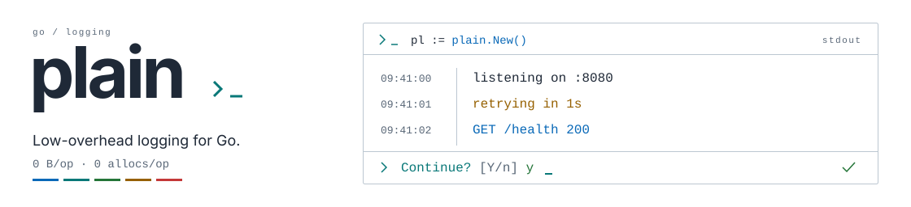

<picture>
  <source media="(prefers-color-scheme: dark)" srcset=".github/banner.svg">
  <source media="(prefers-color-scheme: light)" srcset=".github/banner-light.svg">
  
</picture>

A tiny, super fast logger for Go with a couple of handy input helpers.

### Install
```bash
go get -u github.com/coalaura/plain
```

### Quick start

```go
import (
	"github.com/coalaura/plain"
)

func main() {
	pl := plain.New()

	pl.Debugln("Hello from Debug")
	pl.Println("Hello from Print")
	pl.Warnln("Hello from Warn")
	pl.Errorln("Hello from Error")

	confirmed, _ := pl.ConfirmWithEcho("Confirm", true, " ")

	if confirmed {
		pl.Println("You confirmed")
	} else {
		pl.Println("You declined")
	}

	input, _ := pl.Read("Input: ", 64)

	pl.Printf("You entered '%s'\n", input)

	key, _ := pl.ReadOne("Key: ", true)

	pl.Printf("You entered '%s'\n", string(key))

	hidden, _ := pl.ReadHidden("Hidden: ")

	pl.Printf("You entered '%s'\n", hidden)

	masked, _ := pl.ReadMask("Masked: ", plain.MaskStar)

	pl.Printf("You entered '%s'\n", masked)

	options := []string{"Red", "Green", "Blue", "Yellow"}

	index, _ := pl.Select("Select: ", options)

	pl.Printf("You selected '%s'\n", options[index])

	// shortcut to block till we receive an interrupt
	pl.WaitForInterrupt()

	// cleanup code on exit...
}
```

### Options

```go
// Set output target (defaults to os.Stdout)
pl := plain.New(plain.WithTarget(os.Stderr))

// Enable timestamps with a custom format
pl := plain.New(plain.WithDate(plain.RFC3339Local))

// Update at runtime
pl.SetTarget(os.Stderr)
pl.SetDate("")
```

### HTTP middleware

```go
pl := plain.New()

mux := http.NewServeMux()
// ...

handler := pl.Middleware()(mux)

handler = plain.RealIPMiddleware()(handler)

http.ListenAndServe(":8080", handler)
```

Pass `WithHostAsPeer()` to log the incoming request's `Host` instead of its remote address, with the same port stripping. Options are applied once when creating the middleware.

```go
handler := pl.Middleware(plain.WithHostAsPeer())(mux)
```

`RealIPMiddleware` updates `http.Request.RemoteAddr` from the first valid `X-Real-IP` or `X-Forwarded-For` address. By default, forwarded headers are trusted only from `127.0.0.1`; configure the proxies and headers you trust when deploying behind another proxy:

```go
handler := pl.Middleware()(mux)

handler = plain.RealIPMiddleware(
	plain.WithTrustedProxies("10.0.0.0/8", "192.0.2.10"),
	plain.WithTrustedHeaders(plain.HeaderXForwardedFor),
)(handler)

http.ListenAndServe(":8080", handler)
```

### Error helpers

```go
// Panics if err is not nil
pl.MustFail(err)

// Logs the error and exits with code 1 if err is not nil
pl.MustExit(err)

// Check if an error came from an interrupted read
if plain.IsInterrupted(err) {
	// user pressed Ctrl+C
}
```

### Performance tips

- Prefer `Println`/`Printf` for hot paths to avoid extra formatting work.
- Keep `WithDate("")` (default) when you do not need timestamps.
- Avoid embedding ANSI sequences in messages if color is disabled.
- Reuse a single `Plain` instance instead of creating per call.
- For high-throughput logging, direct output to buffered IO (e.g. `bufio.Writer`).
